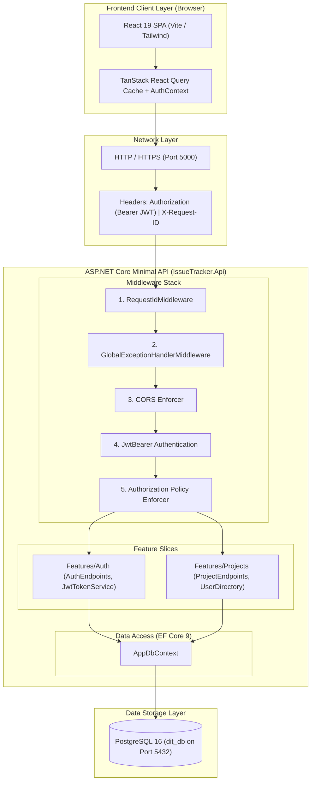
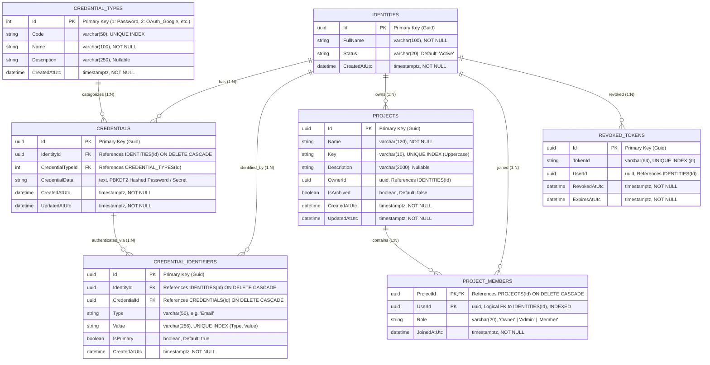
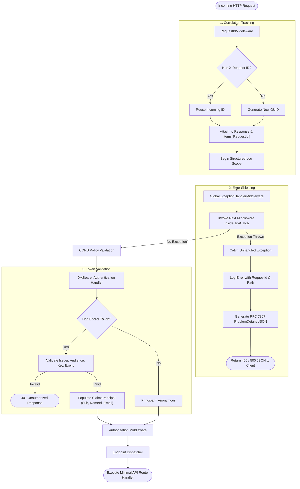
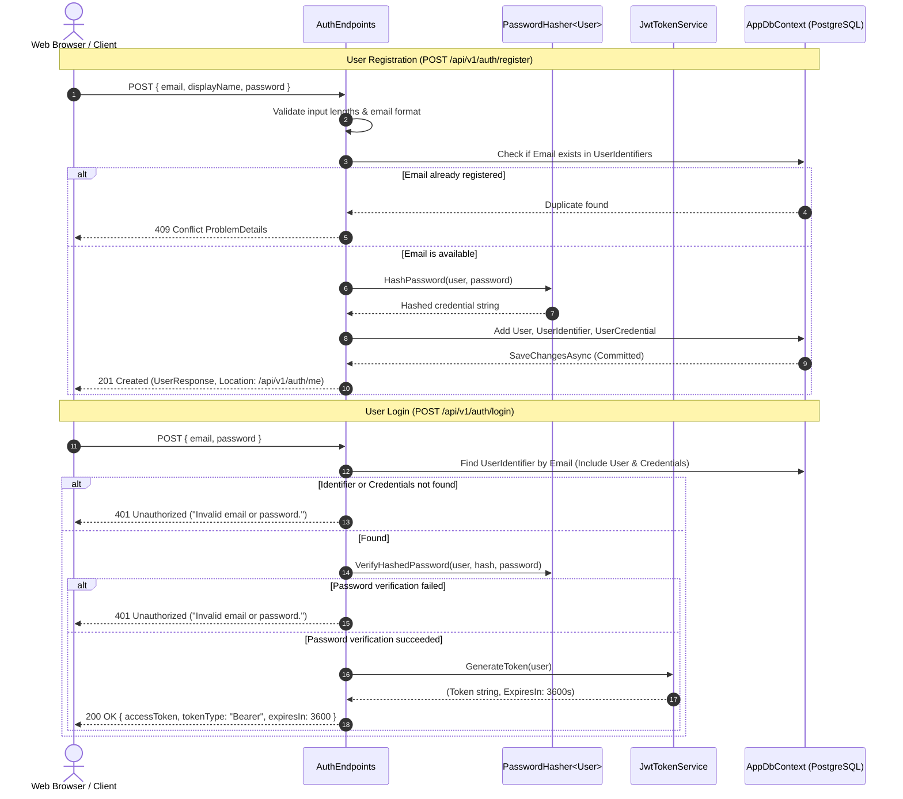
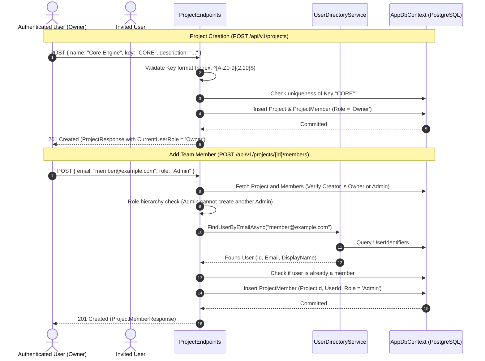
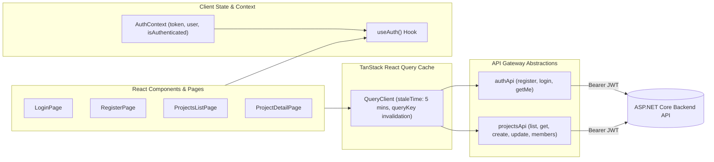

# Distributed Issue Tracker — Comprehensive Architecture, Design & Roadmap Guide

This guide provides an exhaustive, end-to-end breakdown of the **Distributed Issue Tracker (DIT)**. It documents the core architecture, the technical evolution from inception to the current state, in-depth design diagrams, the database schema, security mechanisms, and a concrete, prioritized roadmap for upcoming milestones.

---

## Table of Contents
1. [Executive Summary & Architectural Philosophy](#1-executive-summary--architectural-philosophy)
2. [Technology Stack & Decisions](#2-technology-stack--decisions)
3. [Chronological Project Evolution (Starting to Right Now)](#3-chronological-project-evolution-starting-to-right-now)
4. [In-Depth Visual Diagrams](#4-in-depth-visual-diagrams)
   - [4.1 System Topology & Component Layout](#41-system-topology--component-layout)
   - [4.2 Full Entity-Relationship (ER) Schema](#42-full-entity-relationship-er-schema)
   - [4.3 HTTP Middleware & Request Lifecycle](#43-http-middleware--request-lifecycle)
   - [4.4 Authentication & Token Issuance Flow](#44-authentication--token-issuance-flow)
   - [4.5 Project Creation & RBAC Membership Flow](#45-project-creation--rbac-membership-flow)
   - [4.6 Frontend Reactive State Architecture](#46-frontend-reactive-state-architecture)
5. [Current API Registry & Contracts](#5-current-api-registry--contracts)
6. [Directory & Codebase Blueprint](#6-directory--codebase-blueprint)
7. [What We Should Do Next (Prioritized Next Steps)](#7-what-we-should-do-next-prioritized-next-steps)

---

## 1. Executive Summary & Architectural Philosophy

Modern software projects frequently suffer from **premature distributed microservice complexity**: teams introduce multiple microservices, API gateways, independent deployment pipelines, distributed transactions (Two-Phase Commit / Sagas), network serialization overhead, and multiple ports before the core business logic is validated.

The **Distributed Issue Tracker** solves this with a **Feature-Wise Architecture** (Modular Vertical Slice Monolith):
- **Unified Runtime**: Everything runs in a single, high-performance ASP.NET Core process on port `5000` connected to PostgreSQL on port `5432`.
- **Zero Network Hops**: Feature boundaries interact in-memory rather than over HTTP or message brokers, giving sub-millisecond inter-module resolution.
- **Strict Domain Boundaries**: Each feature (`Auth`, `Projects`, `Issues`) encapsulates its own domain models, data transfer objects, endpoints, and database configurations.
- **Microservice-Ready Extraction**: Features communicate through narrow abstractions (such as `IUserDirectoryService`). If a feature requires independent auto-scaling or team separation in the future, it can be extracted into a separate container with minimal friction.

```
+-------------------------------------------------------------------------+
|                    MODULAR VERTICAL SLICE MONOLITH                      |
|                                                                         |
|  +---------------------+   +---------------------+   +---------------+  |
|  |     Auth Slice      |   |   Projects Slice    |   | Issues Slice  |  |
|  |  (Users/Credentials)|   |  (Workspaces/Teams) |   |   (Tickets)   |  |
|  +----------+----------+   +----------+----------+   +-------+-------+  |
|             |                         |                      |          |
|             \-------------------------+----------------------/          |
|                                       |                                 |
|                      AppDbContext (PostgreSQL dit_db)                   |
+-------------------------------------------------------------------------+
```

---

## 2. Technology Stack & Decisions

### 2.1 Backend Platform
- **Runtime**: **.NET 9 SDK** (`net9.0`) using C# 13 Minimal APIs for low memory footprint and high throughput.
- **Persistence**: **Entity Framework Core 9** with **PostgreSQL** (`Npgsql.EntityFrameworkCore.PostgreSQL`).
- **Security & Cryptography**:
  - `Microsoft.AspNetCore.Identity.PasswordHasher<T>` utilizing PBKDF2 with SHA-256, HMAC, and random salts.
  - `Microsoft.AspNetCore.Authentication.JwtBearer` & `Microsoft.IdentityModel.Tokens` issuing HMAC-SHA256 signed access tokens.
- **Interactive API Documentation**: **Scalar OpenAPI** (`Scalar.AspNetCore`), providing a modern, developer-friendly UI at `/scalar/v1`.
- **Testing**: **xUnit**, `Microsoft.AspNetCore.Mvc.Testing` (`WebApplicationFactory`), and integration tests executing real HTTP requests against test databases.

### 2.2 Frontend Platform
- **Framework**: **React 19** with **Vite 8** and **TypeScript 6**.
- **State & Server Cache**: **TanStack React Query v5** (`@tanstack/react-query`) for cache management, query deduplication, and stale-while-revalidate data fetching.
- **Form Management & Validation**: **React Hook Form** paired with **Zod** schema validation.
- **Styling & UI**: **Tailwind CSS v4**, **Lucide React** icon library, and **Motion** for smooth layout transitions.
- **Code Hygiene**: **Oxlint** for ultra-fast, zero-config linting.

---

## 3. Chronological Project Evolution (Starting to Right Now)

### Phase 1: Inception & Foundational Infrastructure
1. **Repository Foundation**: Initialized ASP.NET Core API with structured JSON console logging and RFC 7807 problem details.
2. **Database Context**: Built `AppDbContext` pointing to PostgreSQL database `dit_db`.
3. **Observability Pipeline**:
   - `RequestIdMiddleware` added to the top of the HTTP pipeline. Inspects incoming headers for `X-Request-ID` or `X-Correlation-ID`; if absent, generates a new GUID, sets response headers, and enriches logging scopes.
4. **Exception Shielding**:
   - `GlobalExceptionHandlerMiddleware` catches unhandled exceptions, logs the error with the correlation ID, and returns an RFC 7807 compliant JSON body, preventing stack trace leakage.

### Phase 2: Authentication & Tripartite User Architecture
1. **Tripartite Identity Schema**: Rather than storing user emails, names, and passwords in a single flattened table, user identity is separated into three normalized tables:
   - `Users`: The persistent root entity (`Id`, `FullName`, `Status`, `CreatedAtUtc`).
   - `UserIdentifiers`: Login handles (`UserId`, `Type` = `"Email"`, `Value`). Designed to allow multiple identifiers per user (e.g. secondary email, phone, SSO handle) with unique index guarantees.
   - `UserCredentials`: Authentication verification records (`UserId`, `Type` = `"Password"`, `CredentialData`). Completely isolates cryptographic hashes from user profiles.
2. **Secure Registration & Login Pipeline**:
   - Registration verifies uniqueness against `UserIdentifiers`, hashes passwords, and returns a safe `UserResponse` without exposing password hashes.
   - Login validates credentials with constant-time comparison and returns a signed JWT containing standard claims (`sub`, `nameid`, `email`, `name`, `jti`).
3. **Protected Current-User Endpoint**:
   - `GET /api/v1/auth/me` validates the Bearer token, extracts the authenticated claims, and retrieves the active user profile.
4. **Frontend Integration**:
   - Built `AuthContext` and `useAuth` hook in React, managing authenticated token state and automatic redirect guards (`AuthGuards.tsx`).

### Phase 3: Workspaces, Projects & Membership RBAC
1. **Project Aggregate**:
   - `Projects`: Encapsulates workspaces with a unique alphanumeric uppercase `Key` (2–10 characters, e.g. `CORE`, `PROJ`), `Name`, `Description`, and `OwnerId`.
   - `ProjectMembers`: Cross-reference table linking users to projects with strongly-typed roles: `Owner`, `Admin`, `Member`.
2. **Role-Based Access Control (RBAC)**:
   - **Owner**: Creator of the project; holds exclusive rights to archive/restore the project and assign the Admin role.
   - **Admin**: Can update project metadata, invite new members, and manage standard member roles.
   - **Member**: Standard team member with view rights.
3. **Cross-Feature Decoupling**:
   - Introduced `IUserDirectoryService` interface so the `Projects` slice can look up member emails and display names without directly coupling to `Auth` entity models.
4. **Project Lifecycle Operations**:
   - Implemented Project Creation, Pagination & Filtered Search, Detail Retrieval, Metadata Updates, Archival, Restoration, Member Listing, Member Addition, Role Modification, Member Removal, and Voluntary Leave.

### Phase 4: Structural Optimization & Clean Naming (Recent Work)
1. **Clean Route Alignment**: Replaced legacy `/api/v1/identity/*` with standard, self-describing `/api/v1/auth/*` routes (`/register`, `/login`, `/me`), while preserving `/api/v1/identity/*` as a backward-compatible alias.
2. **Flattened Directory Hierarchy**:
   - Relocated middleware from `Common/Middleware/` to `backend/src/IssueTracker.Api/Middleware/`.
   - Added fluent extension methods (`app.UseRequestId()`, `app.UseGlobalExceptionHandler()`).
3. **Consolidated Micro-Files**:
   - Merged 4 micro-DTO files into a single `AuthDtos.cs`.
   - Co-located `IJwtTokenService` alongside `JwtTokenService`.
   - Merged `authContextDef.ts` into `AuthContext.tsx` on the frontend.
   - Eliminated redundant `DistributedIssueTracker.slnx` to prevent solution ambiguity.

---

## 4. In-Depth Visual Diagrams

### 4.1 System Topology & Component Layout



---

### 4.2 Full Entity-Relationship (ER) Schema



---

### 4.3 HTTP Middleware & Request Lifecycle



---

### 4.4 Authentication & Token Issuance Flow



---

### 4.5 Project Creation & RBAC Membership Flow



---

### 4.6 Frontend Reactive State Architecture



---

## 5. Current API Registry & Contracts

All endpoints are hosted at base URL `http://localhost:5000` and documented interactively via Scalar at `http://localhost:5000/scalar/v1`.

### 5.1 Authentication Endpoints (`/api/v1/auth`)
*Note: Also available via `/api/v1/identity` for backward compatibility.*

| Verb | Path | Description | Authorization | Request Body | Success Response |
| :--- | :--- | :--- | :---: | :--- | :--- |
| `POST` | `/api/v1/auth/register` | Creates a new user profile with identity, identifier, and credential | Anonymous | `{ email, displayName, password }` | `201 Created` (`UserResponse`) |
| `POST` | `/api/v1/auth/login` | Authenticates user credentials and issues a signed JWT | Anonymous | `{ email, password }` | `200 OK` (`LoginResponse`) |
| `GET` | `/api/v1/auth/me` | Retrieves the authenticated user's profile and verified claims | `Bearer JWT` | None | `200 OK` (`UserResponse`) |

### 5.2 Projects & Workspace Endpoints (`/api/v1/projects`)

| Verb | Path | Description | Required Role | Request Body | Success Response |
| :--- | :--- | :--- | :---: | :--- | :--- |
| `POST` | `/api/v1/projects` | Creates project and designates creator as Owner | Authenticated | `{ name, key, description? }` | `201 Created` (`ProjectResponse`) |
| `GET` | `/api/v1/projects` | Lists projects where the user is a member | Authenticated | Query: `page, pageSize, search, includeArchived` | `200 OK` (`PagedProjectsResponse`) |
| `GET` | `/api/v1/projects/{id}` | Retrieves full metadata of a single project | Member+ | None | `200 OK` (`ProjectResponse`) |
| `PATCH` | `/api/v1/projects/{id}` | Updates project name or description | Owner, Admin | `{ name?, description? }` | `200 OK` (`ProjectResponse`) |
| `POST` | `/api/v1/projects/{id}/archive` | Archives a project (locks edits) | Owner only | None | `200 OK` (`ProjectResponse`) |
| `POST` | `/api/v1/projects/{id}/restore` | Restores an archived project to active status | Owner only | None | `200 OK` (`ProjectResponse`) |

### 5.3 Team Membership Endpoints (`/api/v1/projects/{id}/members`)

| Verb | Path | Description | Required Role | Request Body | Success Response |
| :--- | :--- | :--- | :---: | :--- | :--- |
| `GET` | `/api/v1/projects/{id}/members` | Lists all members in a project | Member+ | None | `200 OK` (`List<ProjectMemberResponse>`) |
| `POST` | `/api/v1/projects/{id}/members` | Adds an existing user by email | Owner, Admin | `{ email, role }` | `201 Created` (`ProjectMemberResponse`) |
| `PATCH` | `/api/v1/projects/{id}/members/{userId}` | Updates a member's role (Admin/Member) | Owner, Admin | `{ role }` | `200 OK` (`ProjectMemberResponse`) |
| `DELETE` | `/api/v1/projects/{id}/members/{userId}` | Removes a member from the project | Owner, Admin | None | `204 No Content` |
| `POST` | `/api/v1/projects/{id}/leave` | Allows non-Owners to voluntarily leave | Member, Admin | None | `204 No Content` |

---

## 6. Directory & Codebase Blueprint

```
DistributedIssueTracker/
├── backend/
│   ├── DistributedIssueTracker.sln         # Unified solution file
│   ├── src/
│   │   └── IssueTracker.Api/
│   │       ├── Data/
│   │       │   ├── AppDbContext.cs         # Entity Framework Core root DbContext
│   │       │   └── Migrations/             # Database migration history
│   │       ├── Features/
│   │       │   ├── Auth/                   # Milestone 2: Auth Slice
│   │       │   │   ├── AuthEndpoints.cs    # Minimal API endpoints (/api/v1/auth)
│   │       │   │   ├── Data/               # Entity configs (User, Credentials, Identifiers)
│   │       │   │   ├── Dtos/               # Cohesive Auth DTOs (AuthDtos.cs)
│   │       │   │   ├── Models/             # Domain entities (User, UserCredential, UserIdentifier)
│   │       │   │   └── Services/           # JwtTokenService, UserDirectoryService
│   │       │   └── Projects/               # Milestone 3: Projects Slice
│   │       │       ├── ProjectEndpoints.cs # Minimal API endpoints (/api/v1/projects)
│   │       │       ├── Data/               # Entity configs (Project, ProjectMember)
│   │       │       ├── Dtos/               # ProjectDtos.cs, ProjectMemberDtos.cs
│   │       │       ├── Models/             # Project, ProjectMember, ProjectRole
│   │       │       └── Services/           # IUserDirectoryService interface
│   │       ├── Middleware/                 # Shared pipeline filters
│   │       │   ├── GlobalExceptionHandlerMiddleware.cs # RFC 7807 problem details
│   │       │   ├── RequestIdMiddleware.cs  # Correlation ID generator & logger scope
│   │       │   └── MiddlewareExtensions.cs # Fluent pipeline extension methods
│   │       ├── Program.cs                  # WebApplication entrypoint & pipeline builder
│   │       └── appsettings.json            # Database connection & JWT config
│   └── tests/
│       └── IssueTracker.Api.Tests/
│           ├── ApiTests.cs                 # Middleware, header, and correlation tests
│           ├── AuthTests.cs                # 12 end-to-end auth integration test scenarios
│           └── ProjectTests.cs             # 17 end-to-end project & RBAC test scenarios
├── frontend/
│   └── web/
│       ├── src/
│       │   ├── app/                        # App root, React Query client, React Router
│       │   ├── features/
│       │   │   ├── auth/                   # Auth components, forms, contexts, and api client
│       │   │   ├── dashboard/              # Developer overview and system statistics
│       │   │   └── projects/               # Project listing, detail, member management
│       │   ├── layouts/                    # AppLayout (navigation) & AuthLayout
│       │   └── shared/                     # Reusable UI primitives (Button, Card, Input, Modal, etc.)
│       ├── package.json
│       └── vite.config.ts
└── docs/
    ├── architecture/architecture.md        # Architectural summary
    └── PROJECT_GUIDE.md                    # This master document
```

---

## 7. What We Should Do Next (Prioritized Next Steps)

Now that **Milestone 1 (Foundations & Observability)**, **Milestone 2 (Authentication & JWT)**, and **Milestone 3 (Workspaces, Projects & Membership)** are fully tested and operating smoothly, here is the structured, engineering-first roadmap for next steps:

### Milestone 4: Issue & Ticket Tracking Engine (Immediate Priority)
The heart of an issue tracking system is the issue lifecycle.

#### Step 4.1: Database Schema & Entity Design
Create the `Issues` feature slice under `Features/Issues`:
- **Domain Model**: `Issue`
  ```csharp
  public class Issue
  {
      public Guid Id { get; set; }
      public Guid ProjectId { get; set; }
      public int IssueNumber { get; set; } // Sequential within project: 1, 2, 3...
      public string Key { get; set; } = string.Empty; // e.g. "CORE-101"
      public string Title { get; set; } = string.Empty;
      public string? Description { get; set; }
      public IssueType Type { get; set; } // Bug, Feature, Task
      public IssueStatus Status { get; set; } // Todo, InProgress, InReview, Done
      public IssuePriority Priority { get; set; } // Low, Medium, High, Urgent
      public Guid ReporterId { get; set; }
      public Guid? AssigneeId { get; set; }
      public DateTime CreatedAtUtc { get; set; }
      public DateTime UpdatedAtUtc { get; set; }
  }
  ```
- **Sequential Key Generation**: Implement an atomic sequence generator so `IssueNumber` increments safely per-project (producing identifiers like `CORE-1`, `CORE-2`) without concurrency race conditions.
- **Indices**: Composite unique index on `(ProjectId, IssueNumber)` and index on `Key`.

#### Step 4.2: Endpoints & Business Logic
- `POST /api/v1/projects/{projectId}/issues`: Create issue (auto-generates `IssueNumber` and `Key`).
- `GET /api/v1/projects/{projectId}/issues`: List issues with pagination, full-text search, and multi-parameter filtering (`status`, `priority`, `type`, `assigneeId`).
- `GET /api/v1/projects/{projectId}/issues/{issueId}` or `GET /api/v1/issues/{issueKey}`: Fetch issue details.
- `PATCH /api/v1/projects/{projectId}/issues/{issueId}`: Update title, description, priority, or type.
- `PATCH /api/v1/projects/{projectId}/issues/{issueId}/assign`: Reassign issue to another project member.
- `PATCH /api/v1/projects/{projectId}/issues/{issueId}/status`: Transition issue status.

---

### Milestone 5: Comments & Audit Activity Trail
1. **Comments Engine**:
   - `IssueComment`: `Id`, `IssueId`, `AuthorId`, `Body`, `CreatedAtUtc`, `UpdatedAtUtc`.
   - Threaded discussion on tickets.
2. **Audit Activity Log**:
   - `IssueActivity`: `Id`, `IssueId`, `ActorId`, `ActivityType` (StatusChanged, Assigned, PriorityChanged), `OldValue`, `NewValue`, `TimestampUtc`.
   - Gives team members full visibility into ticket changes.

---

### Milestone 6: Interactive Kanban Board & Frontend Issue Management
1. **Interactive Kanban Board View**:
   - Four distinct workflow columns: **To Do**, **In Progress**, **In Review**, **Done**.
   - Drag-and-drop or one-click status transitions calling `PATCH /status`.
2. **Issue Detail Drawer / Modal**:
   - Rich Markdown description viewer/editor.
   - Assignee selection dropdown filtering only active project members.
   - Priority badges and visual status indicators.

---

### Milestone 7: Real-Time Synchronization (SignalR)
1. **WebSockets / SignalR Hub**:
   - Create `IssueHub` on `/hubs/issues`.
   - Broadcast events when issues are moved on the Kanban board or comments are posted.
   - Prevents stale state when multiple team members view the same board simultaneously.

---

### Milestone 8: Production Readiness & Deployment
1. **Containerization**:
   - Multi-stage `Dockerfile` for `IssueTracker.Api`.
   - `docker-compose.yml` orchestrating PostgreSQL, ASP.NET Core API, and Nginx frontend SPA.
2. **Observability**:
   - Integrate OpenTelemetry for distributed tracing and Prometheus endpoint (`/metrics`).
3. **CI/CD Pipeline**:
   - GitHub Actions workflow running `dotnet test` and `npm run build` on every push/PR.
